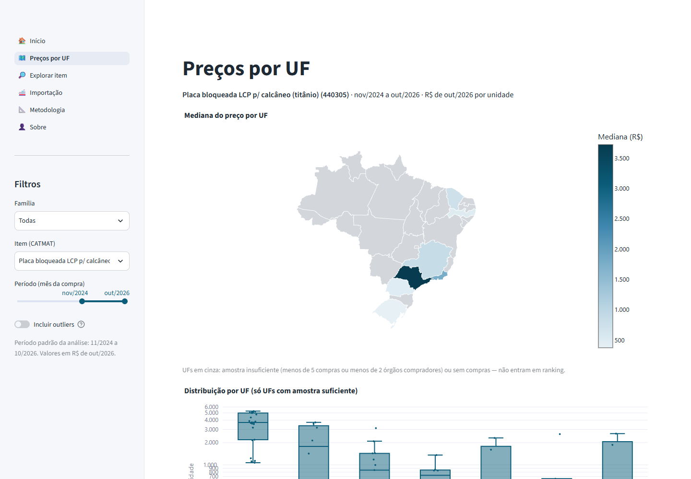
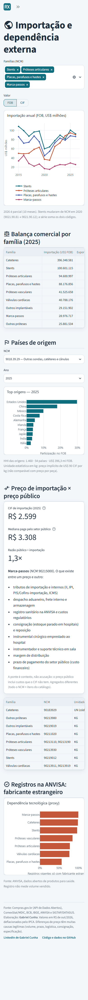
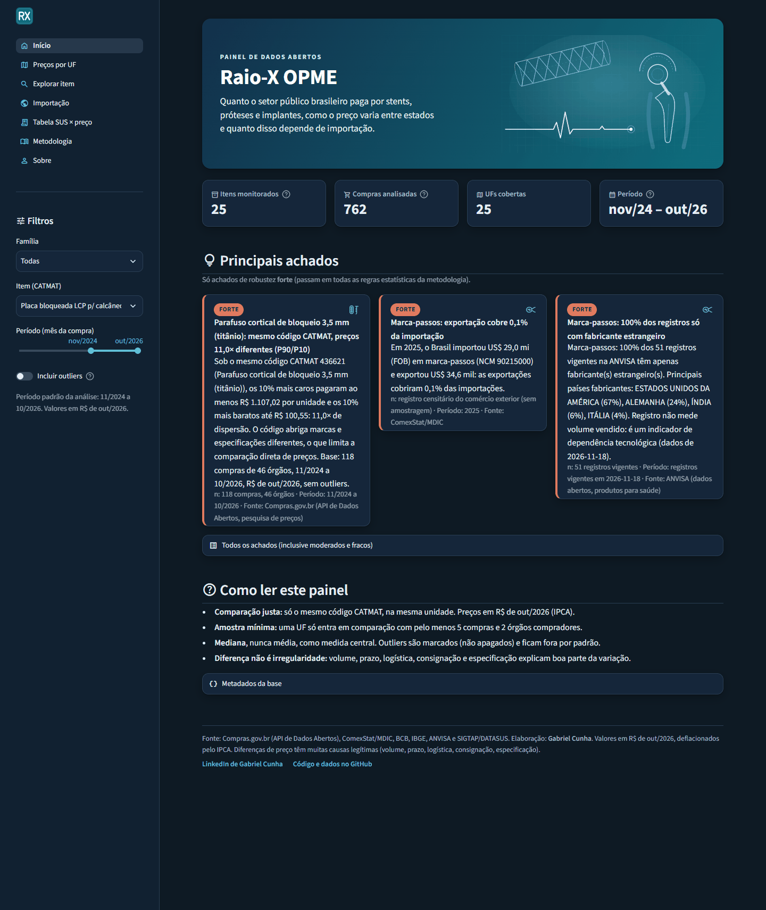
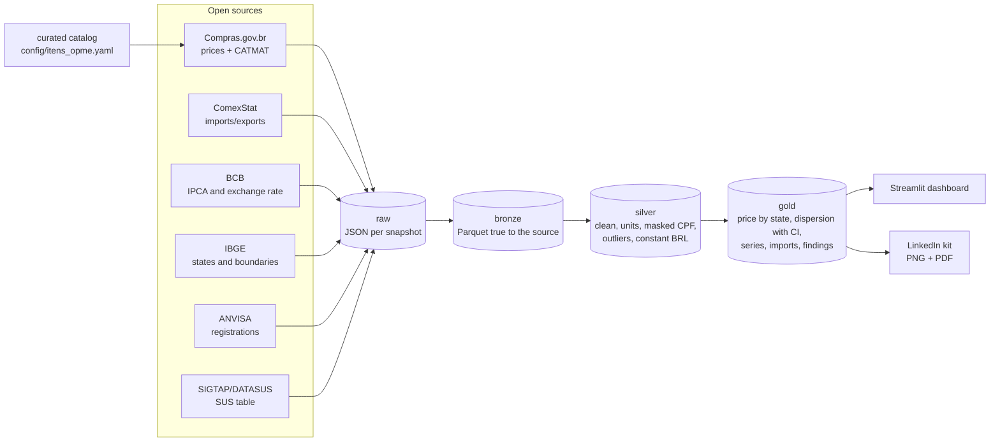

**English** · [Português](README.pt-BR.md)

# Raio-X OPME

**What Brazil's public sector pays for stents, prostheses and implants — and how much of that depends on imports.**

Read the data story: [What Brazil's public sector pays for implants](https://gorc-supply.github.io/stories/opme-prices.html)

[](https://github.com/gorcxpg-opme/raio-x-opme/actions/workflows/ci.yml)
[](LICENSE)
[](https://www.python.org/)
[](docs/FONTES.md)


<details>
<summary>More dashboard screens (desktop, mobile and dark mode)</summary>

| Page | Desktop (1440 px) | Mobile (390 px) |
|---|---|---|
| Prices by state |  |  |
| Explore item |  |  |
| Imports |  |  |
| SUS table × price |  |  |
| Home (dark mode) |  |  |

</details>

## What this project answers

1. **How much does the public sector pay** for OPME items (orthoses, prostheses and special materials) such as stents,
   joint prostheses, plates and screws, pacemakers, endoprostheses and catheters?
2. **Does the same item cost more in some states?** How confidently can we say so?
3. **How dependent is the country on imports** for these items — and from which countries?

## Key findings

Data collected on November 18, 2026. Purchases from Nov 2024 to Oct 2026, in Oct 2026 BRL (IPCA). Only findings with
**strong** robustness ([criteria](docs/METODOLOGIA.md)).

1. **Pacemakers depend 100% on foreign manufacturers.** The 51 active ANVISA registrations list only a
   foreign manufacturer; in 2025 Brazil imported US$ 29.0 million (FOB) and exported US$ 34.6 thousand (0.1%).
   *Sources: ANVISA; ComexStat/MDIC.*
2. **Stents: for every US$ 100 imported, US$ 2.80 exported.** In 2025: US$ 100.6 million in imports against
   US$ 2.8 million in exports; 97% of the 133 active registrations list only a foreign manufacturer.
   *Sources: ComexStat/MDIC; ANVISA.*
3. **The same catalog code hides very different prices.** The 4.5 mm cortical locking screw
   (CATMAT 443323) had a P10 of R$ 24 and a P90 of R$ 766 per unit (96 purchases, 50 agencies). In 11 of the 25 items,
   P90/P10 exceeds 5×: comparing states on these items measures the brand mix, not the price.
   *Source: Compras.gov.br.*

And one result that counts as a finding: **no price gap between states (UFs) passed every rule**
needed to be called strong (7 moderate signals, 12 weak, 6 items without enough sample). Details in
[docs/ACHADOS.md](docs/ACHADOS.md).

## Dashboard

**https://raio-x-opme.streamlit.app** — map by state, price distribution, real-terms series, suppliers,
individual purchases with a link to the record, imports, SUS table × price paid and methodology. The dashboard only reads `data/gold/` and
`data/reference/`: it does not call any API.

## How it works



Validation with `pandera` on silver and gold (a schema failure stops the pipeline), HTTP client with retry,
rate limiting, daily cache and resume, offline mode with real samples (`data/fixtures/`) and automatic
monthly refresh via GitHub Actions.

## How to run (4 commands)

Requires [uv](https://docs.astral.sh/uv/) and git. Works on Windows, Linux and macOS.

```bash
git clone https://github.com/gorcxpg-opme/raio-x-opme.git
cd raio-x-opme
uv sync
uv run raiox all            # collects and processes everything (~5 min); without internet: uv run raiox all --offline
uv run streamlit run app/Home.py
```

Other commands: `uv run raiox --help`, `uv run pytest`, `uv run ruff check .`, `uv run raiox catalog build`.

> **Windows with Smart App Control:** if Windows blocks `streamlit.exe` or `pytest.exe`, use
> `uv run python -m streamlit run app/Home.py` and `uv run python -m pytest`. The effect is the same.

### Publish the dashboard (Streamlit Community Cloud, free)

1. Push the repository to GitHub (public).
2. On [share.streamlit.io](https://share.streamlit.io), *Create app* → select the repository, branch `main`
   and the main file **`app/Home.py`**.
3. Under *Advanced settings*, choose **Python 3.12**. Dependencies come from `requirements.txt` (generated from
   `uv.lock` and checked by CI).
4. Choose the subdomain `raio-x-opme` (or another one, and update `project.dashboard_url` in `config/settings.yaml`).

## Sources and licenses

| Source | Use | License/terms |
|---|---|---|
| [Compras.gov.br — Open Data API](https://dadosabertos.compras.gov.br/swagger-ui/index.html) | Prices paid and CATMAT catalog | Open data (Decree No. 8,777/2016) |
| [ComexStat/MDIC](https://comexstat.mdic.gov.br) | Imports and exports by NCM | Open data |
| [Central Bank — SGS](https://www3.bcb.gov.br/sgspub) | IPCA (433) and exchange rate (3698) | Open data |
| [IBGE — localities and boundaries API](https://servicodados.ibge.gov.br/api/docs/localidades) | States and territorial boundaries | Open data |
| [ANVISA — open data](https://dados.anvisa.gov.br/dados/) | Health product registrations | Open data |
| [SIGTAP/DATASUS — Unified Table](http://sigtap.datasus.gov.br/tabela-unificada/app/download.jsp) | SUS table value for OPME (2015–2026) | CC BY 3.0 |

Code under the [MIT](LICENSE) license. The data belongs to its sources; cite them when reusing it. Technical details of
each endpoint in [docs/FONTES.md](docs/FONTES.md); table columns in
[docs/DICIONARIO_DADOS.md](docs/DICIONARIO_DADOS.md).

## Limitations

- Covers only purchases recorded in Compras.gov.br (federal and part of states and municipalities).
- The same CATMAT code can hold different brands and specifications; that is why there is a
  homogeneity check before any comparison between states.
- Samples per state are small: most items have few comparable states.
- Implant imports are measured in kg (except pacemakers), which rules out a price per piece.
- A price gap is **not** a synonym for irregularity: volume, delivery time, logistics, consignment,
  specification and urgency explain much of the variation.

Full list in [docs/METODOLOGIA.md](docs/METODOLOGIA.md#11-limitações-conhecidas).

## Roadmap

- [ ] Items from PNCP procurements (Law 14,133) once the endpoint stabilizes — widens coverage of states and municipalities.
- [ ] "Same brand, different states" comparison to separate price from product mix.
- [ ] Full Banco de Preços em Saúde (BPS, health price database), if there is an open dataset with OPME.
- [x] SIGTAP table (SUS reference value) × price paid (SIGTAP × CATMAT map validated).
- [ ] More items in the catalog as the history builds up.

## Author

**Gabriel Cunha** — Supply Chain & Operations, with hands-on OPME experience.
[LinkedIn](https://www.linkedin.com/in/gabriel-cunha-xp)

Suggestions and criticism of the methodology are very welcome (open an *issue*).

<details>
<summary>To paste into GitHub (description and topics)</summary>

**Short description:** What Brazil's public sector pays for stents, prostheses and implants: open pipeline + dashboard with prices by state, dispersion with CI and import dependence.

**Topics:** `opme` `compras-publicas` `dados-abertos` `saude-publica` `supply-chain` `streamlit` `polars` `duckdb` `data-engineering` `brazil` `healthcare` `procurement` `open-data`

</details>
