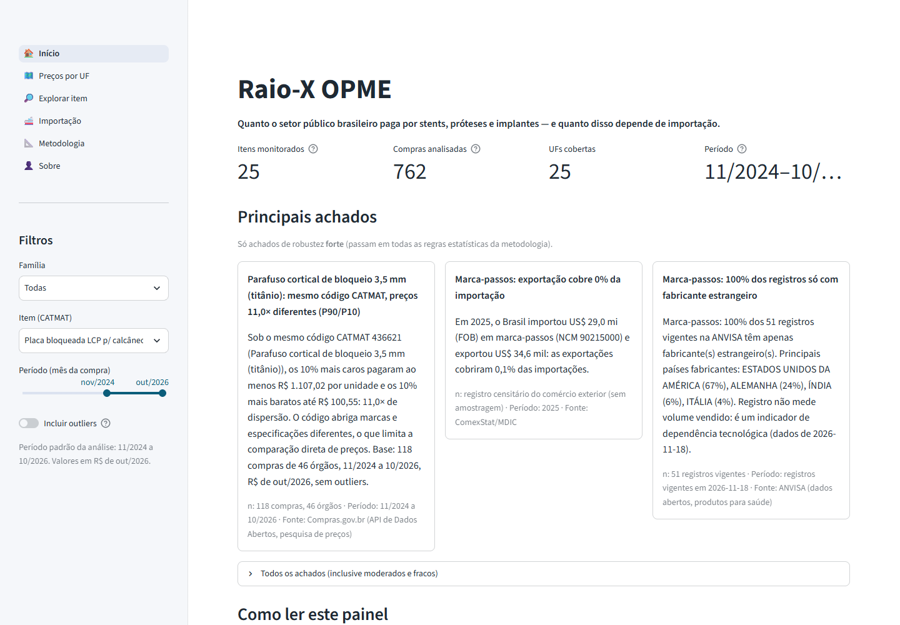
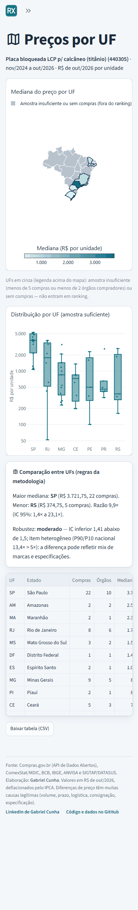
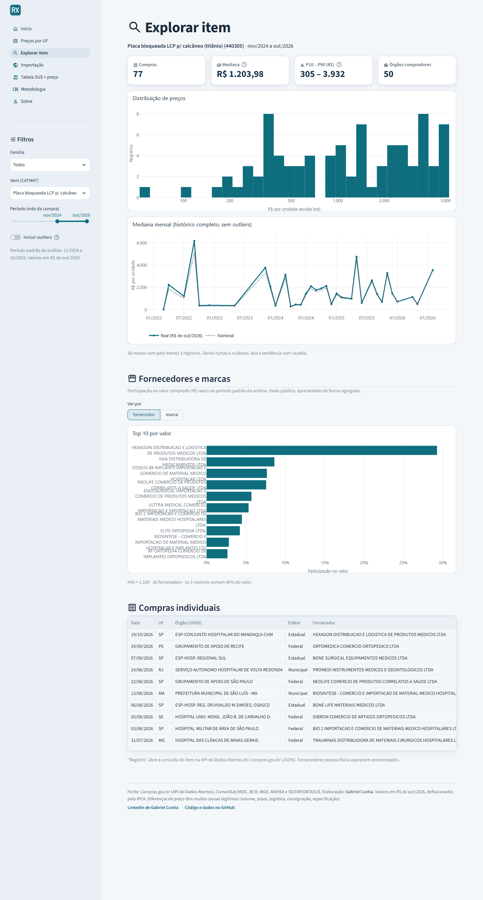
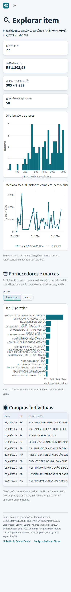
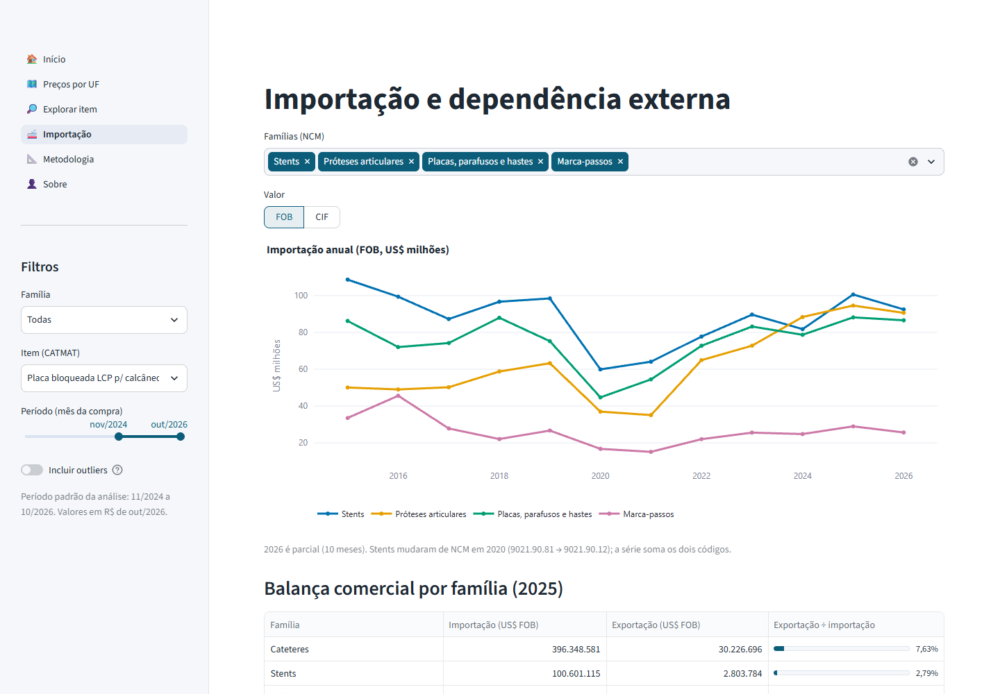
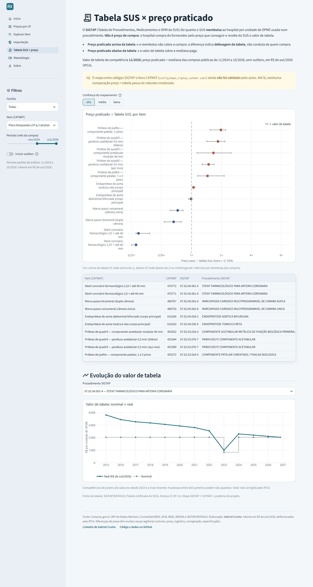
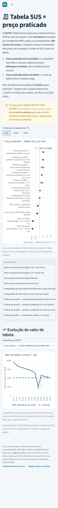
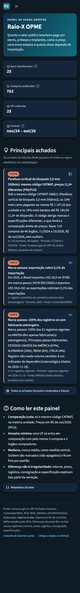
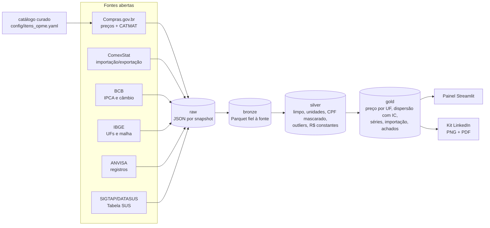

# Raio-X OPME

**Quanto o setor público brasileiro paga por stents, próteses e implantes — e quanto disso depende de importação.**

[](https://github.com/gorcxpg-opme/raio-x-opme/actions/workflows/ci.yml)
[](LICENSE)
[](https://www.python.org/)
[](docs/FONTES.md)



<details>
<summary>Mais telas do painel (desktop, celular e modo escuro)</summary>

| Página | Desktop (1440 px) | Celular (390 px) |
|---|---|---|
| Preços por UF |  |  |
| Explorar item |  |  |
| Importação |  |  |
| Tabela SUS × preço |  |  |
| Início (modo escuro) |  |  |

</details>

## O que este projeto responde

1. **Quanto o setor público paga** por itens de OPME (órteses, próteses e materiais especiais) como stents,
   próteses articulares, placas e parafusos, marca-passos, endopróteses e cateteres?
2. **O mesmo item custa mais caro em alguns estados?** Com que confiança dá para afirmar isso?
3. **Quanto o país depende de importação** nesses itens — e de quais países?

## Principais achados

Dados coletados em 18/11/2026. Compras de 11/2024 a 10/2026, em R$ de out/2026 (IPCA). Só achados de
robustez **forte** ([critérios](docs/METODOLOGIA.md)).

1. **Marca-passos dependem 100% de fabricantes estrangeiros.** Os 51 registros vigentes na ANVISA têm apenas
   fabricante estrangeiro; em 2025 o Brasil importou US$ 29,0 mi (FOB) e exportou US$ 34,6 mil (0,1%).
   *Fontes: ANVISA; ComexStat/MDIC.*
2. **Stents: para cada US$ 100 importados, US$ 2,80 exportados.** Em 2025: US$ 100,6 mi de importação contra
   US$ 2,8 mi de exportação; 97% dos 133 registros vigentes só têm fabricante estrangeiro.
   *Fontes: ComexStat/MDIC; ANVISA.*
3. **O mesmo código de catálogo esconde preços muito diferentes.** O parafuso cortical de bloqueio 4,5 mm
   (CATMAT 443323) teve P10 de R$ 24 e P90 de R$ 766 por unidade (96 compras, 50 órgãos). Em 11 dos 25 itens,
   P90/P10 passa de 5×: comparar estados nesses itens mede o mix de marcas, não o preço.
   *Fonte: Compras.gov.br.*

E um resultado que vale como achado: **nenhuma diferença de preço entre UFs passou em todas as regras**
para ser chamada de forte (7 indícios moderados, 12 fracos, 6 itens sem amostra). Detalhes em
[docs/ACHADOS.md](docs/ACHADOS.md).

## Painel

**https://raio-x-opme.streamlit.app** — mapa por UF, distribuição de preços, série real, fornecedores,
compras individuais com link para o registro, importação, Tabela SUS × preço praticado e metodologia. O painel só lê `data/gold/` e
`data/reference/`: não chama nenhuma API.

## Como funciona



Validação com `pandera` na silver e na gold (falha de schema derruba o pipeline), cliente HTTP com retry,
rate limit, cache diário e retomada, modo offline com amostras reais (`data/fixtures/`) e atualização
mensal automática via GitHub Actions.

## Como rodar (4 comandos)

Requer [uv](https://docs.astral.sh/uv/) e git. Funciona em Windows, Linux e macOS.

```bash
git clone https://github.com/gorcxpg-opme/raio-x-opme.git
cd raio-x-opme
uv sync
uv run raiox all            # coleta e processa tudo (~5 min); sem internet: uv run raiox all --offline
uv run streamlit run app/Home.py
```

Outros comandos: `uv run raiox --help`, `uv run pytest`, `uv run ruff check .`, `uv run raiox catalog build`.

> **Windows com Smart App Control:** se o Windows bloquear `streamlit.exe` ou `pytest.exe`, use
> `uv run python -m streamlit run app/Home.py` e `uv run python -m pytest`. O efeito é o mesmo.

### Publicar o painel (Streamlit Community Cloud, gratuito)

1. Faça o push do repositório para o GitHub (público).
2. Em [share.streamlit.io](https://share.streamlit.io), *Create app* → selecione o repositório, branch `main`
   e o arquivo principal **`app/Home.py`**.
3. Em *Advanced settings*, escolha **Python 3.12**. As dependências vêm do `requirements.txt` (gerado do
   `uv.lock` e conferido pelo CI).
4. Escolha o subdomínio `raio-x-opme` (ou outro e atualize `project.dashboard_url` em `config/settings.yaml`).

## Fontes e licenças

| Fonte | Uso | Licença/termos |
|---|---|---|
| [Compras.gov.br — API de Dados Abertos](https://dadosabertos.compras.gov.br/swagger-ui/index.html) | Preços praticados e catálogo CATMAT | Dados abertos (Decreto nº 8.777/2016) |
| [ComexStat/MDIC](https://comexstat.mdic.gov.br) | Importação e exportação por NCM | Dados abertos |
| [Banco Central — SGS](https://www3.bcb.gov.br/sgspub) | IPCA (433) e câmbio (3698) | Dados abertos |
| [IBGE — API de localidades e malhas](https://servicodados.ibge.gov.br/api/docs/localidades) | UFs e malha territorial | Dados abertos |
| [ANVISA — dados abertos](https://dados.anvisa.gov.br/dados/) | Registros de produtos para saúde | Dados abertos |
| [SIGTAP/DATASUS — Tabela Unificada](http://sigtap.datasus.gov.br/tabela-unificada/app/download.jsp) | Valor de tabela SUS para OPME (2015–2026) | CC BY 3.0 |

Código sob licença [MIT](LICENSE). Dados pertencem às fontes; cite-as ao reutilizar. Detalhes técnicos de
cada endpoint em [docs/FONTES.md](docs/FONTES.md); colunas das tabelas em
[docs/DICIONARIO_DADOS.md](docs/DICIONARIO_DADOS.md).

## Limitações

- Cobre só compras registradas no Compras.gov.br (federal e parte de estados e municípios).
- O mesmo código CATMAT pode abrigar marcas e especificações diferentes; por isso há uma trava de
  homogeneidade antes de qualquer comparação entre estados.
- Amostras por UF são pequenas: a maioria dos itens tem poucas UFs comparáveis.
- Importação de implantes é medida em kg (exceto marca-passos), o que impede preço por peça.
- Diferença de preço **não** é sinônimo de irregularidade: volume, prazo, logística, consignação,
  especificação e urgência explicam boa parte da variação.

Lista completa em [docs/METODOLOGIA.md](docs/METODOLOGIA.md#11-limitações-conhecidas).

## Roadmap

- [ ] Itens de contratações PNCP (Lei 14.133) quando o endpoint estabilizar — amplia estados e municípios.
- [ ] Comparação "mesma marca, estados diferentes" para separar preço de mix de produtos.
- [ ] Banco de Preços em Saúde (BPS) completo, se houver base aberta com OPME.
- [x] Tabela SIGTAP (valor de referência SUS) × preço praticado (mapa SIGTAP × CATMAT validado).
- [ ] Mais itens no catálogo à medida que o histórico acumula.

## Autor

**Gabriel Cunha** — Supply Chain & Operations, com vivência em OPME.
[LinkedIn](https://www.linkedin.com/in/gabriel-cunha-xp)

Sugestões e críticas à metodologia são muito bem-vindas (abra uma *issue*).

<details>
<summary>Para colar no GitHub (descrição e topics)</summary>

**Descrição curta:** Quanto o setor público brasileiro paga por stents, próteses e implantes: pipeline aberto + painel com preços por UF, dispersão com IC e dependência de importação.

**Topics:** `opme` `compras-publicas` `dados-abertos` `saude-publica` `supply-chain` `streamlit` `polars` `duckdb` `data-engineering` `brazil` `healthcare` `procurement` `open-data`

</details>

---

## English summary

**Raio-X OPME** is an open-source data pipeline and dashboard on what Brazil's public sector pays for
implantable medical devices (stents, joint prostheses, plates and screws, pacemakers, endoprostheses,
catheters), how prices vary across states, and how dependent the country is on imports. It pulls only
open, no-auth sources (Compras.gov.br open-data API, ComexStat, Central Bank, IBGE, ANVISA), builds a
raw → bronze → silver → gold lakehouse with Polars/DuckDB and pandera validation, and publishes a Streamlit
dashboard plus LinkedIn-ready charts. Price comparisons only use the same catalog code and unit, require a
minimum sample per state, use medians in inflation-adjusted BRL, and report cluster-bootstrap confidence
intervals. Key results (Nov/2026 data): pacemakers are 100% foreign-made by ANVISA registrations and import
coverage by exports is 0.1%; Brazil imported US$ 100.6M in stents in 2025 versus US$ 2.8M exported; and no
state-level price gap passed all robustness rules — mostly because a single catalog code often bundles
different brands and specifications. Run it with `uv sync`, then `uv run raiox all`, then `uv run streamlit run app/Home.py`.
MIT licensed.
